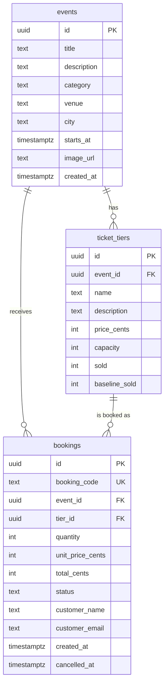

# Database documentation

**DBMS:** PostgreSQL (hosted on Supabase) · **Access:** Supabase client + Postgres functions (RPC) · **Security:** Row Level Security (RLS)

## ER diagram



## Data dictionary (key rules)

| Table | Rule | How it is enforced |
|---|---|---|
| ticket_tiers | price >= 0, capacity >= 0, 0 <= sold <= capacity | `CHECK` constraints |
| bookings | quantity is 1-10 | `CHECK` + validation in `create_booking` |
| bookings | total = unit price x quantity | `CHECK bookings_total_matches` |
| bookings | email is lowercase and valid | `CHECK bookings_email_format` |
| bookings | status is `confirmed` or `cancelled`, `cancelled_at` set only when cancelled | `CHECK` constraints |
| bookings | booking's event must be the tier's event | composite FK `(tier_id, event_id)` |
| bookings | booking code is unique | `UNIQUE (booking_code)` |
| events | cannot be deleted while bookings exist | `ON DELETE RESTRICT` |

## Design decisions (why it looks like this)

- **Money as integer cents** (`price_cents`) to avoid floating-point rounding errors.
- **Price snapshot:** `bookings.unit_price_cents` copies the price at booking time, so later price changes do not rewrite history.
- **No overselling:** `create_booking` locks the tier row (`SELECT ... FOR UPDATE`), so two simultaneous buyers cannot take the last ticket.
- **Denormalized counter `sold`:** fast availability checks without `SUM()` on every page view. The trade-off is that it can drift, so the view `v_sold_integrity` audits it (`sold = baseline_sold + confirmed bookings`).
- **No direct table access for customers:** `bookings` has RLS enabled and no policies. Customers only use `create_booking`, `get_booking` and `cancel_booking`, which require the booking code + email.
- **Soft cancel:** cancelled bookings stay in the table (`status = 'cancelled'`) for history and statistics.

## Functions

| Function | Purpose |
|---|---|
| `create_booking(tier, qty, name, email)` | Validates input, rejects past events, enforces 10 tickets per email per event, checks capacity under lock, creates booking |
| `get_booking(code, email)` | Returns a booking only if code **and** email match |
| `cancel_booking(code, email)` | Cancels a future booking and returns tickets to the tier |

## Views (admin only, not exposed to the public API)

- `v_event_stats` - capacity, tickets sold, occupancy %, revenue, confirmed/cancelled bookings per event.
- `v_sold_integrity` - audit that every tier counter matches its confirmed bookings.

## How to apply and test

1. Run the original migration, then `supabase/migrations/20261102120000_database_improvements.sql` in the Supabase SQL editor (try it on a dev project first).
2. Run `supabase/tests/db_checks.sql`. "Success" means all 13 checks passed; a failure names the broken rule.
3. Look at the data:

```sql
SELECT * FROM v_event_stats ORDER BY starts_at;
SELECT * FROM v_sold_integrity;
```

## Known limitations / next steps

- Seed events have fixed dates (Nov-Dec 2026) and will become past events; add a seed script with relative dates.
- Customers are stored inside `bookings` (name, email). A separate `customers` table would be the next normalization step if we add accounts.
- `category`, `venue` and `city` are free text; separate lookup tables would prevent typos.
- No admin role yet: creating events is done by migration/SQL.
