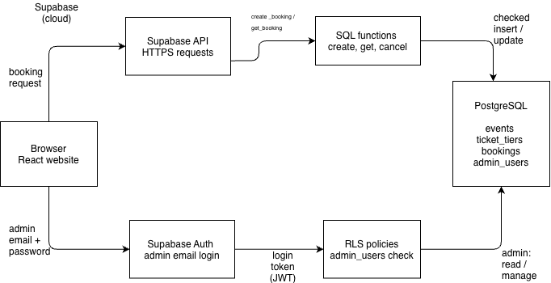

# Security documentation: Stagepass

Author: Turarbekova Dinara (Architecture & Security), Team 6
Date: 2026-11-09
Status: draft. Section 5 results will be added after the tests are run.

## 1. Purpose

This document describes how Stagepass protects its data: who can access what, which threats we considered, how each threat is controlled, and how we test access control.

## 2. Architecture

The React website runs in the user's browser and talks to Supabase over HTTPS. Supabase provides the API, the authentication service (Auth) and the PostgreSQL database.

- Guest path: the website calls SQL functions (`create_booking`, `get_booking`, `cancel_booking`) through the Supabase API. The functions check the input and read or write the database.
- Admin path: the admin signs in with Supabase Auth. Row Level Security (RLS) policies then check that the user exists in the `admin_users` table before allowing admin actions.
- Customers never read the `bookings` table directly.

## 3. Roles and access

| Role | Can do | Cannot do | Enforced in |
|---|---|---|---|
| Guest (anon) | Read events and ticket types. Create a booking. Look up a booking with booking code and email. Cancel a future booking with code and email. | Read the `bookings` table. Read `admin_users` or admin views. Create, edit or delete events. | `20261101171058_create_ticket_booking_system.sql`, `20261102120000_database_improvements.sql` |
| Registered customer (signed in, not admin) | Same as guest. See own tickets on the "My tickets" page (`get_my_bookings` filters by `auth.jwt() ->> 'email'`). | Open admin data. The account is not in `admin_users`, so no admin policy applies. | `20261102180000_admin_panel.sql`, `20261102190000_admin_panel_hardening.sql`, `src/lib/adminApi.ts`, `20261102200000_my_bookings_status.sql` |
| Admin | Create, edit and delete events and ticket types. Read all bookings. | Change bookings directly in the table (only a SELECT policy exists). | `20261102180000_admin_panel.sql` |

## 4. Threats and controls

| # | Threat | Control | Evidence | Remaining risk |
|---|---|---|---|---|
| 1 | Tickets are oversold | `create_booking` locks the ticket tier row (`SELECT ... FOR UPDATE`). A `CHECK` constraint keeps `sold <= capacity`. | `docs/DATABASE.md`, `supabase/tests/db_checks.sql` | The `sold` counter is denormalized. The view `v_sold_integrity` audits it. |
| 2 | Someone reads or changes bookings directly | RLS is enabled on all tables. `bookings` has no public policy, so customers only use the functions. | `20261101171058_create_ticket_booking_system.sql` | None known for guests. |
| 3 | Someone guesses a booking code | `get_booking` and `cancel_booking` require the booking code and the matching email. | `20261101171058_...sql`, `20261102120000_...sql` | No rate limiting. Code length and randomness still need to be reviewed. |
| 4 | Unauthorized access to the admin panel | Supabase Auth login, membership in `admin_users`, and RLS admin policies. The check in the website is only for the interface. The real protection is the RLS policies. | `20261102180000_admin_panel.sql`, `src/lib/adminApi.ts` | One admin account with a password and no second factor. |
| 5 | Invalid or malicious input | `CHECK` constraints (quantity 1-10, total equals unit price times quantity, valid lowercase email) and validation inside `create_booking`. A limit of 10 tickets per email per event. | `docs/DATABASE.md` (data dictionary), migration files | Free-text fields (category, venue, city) can contain typos. |
| 6 | A secret key is exposed | The SQL comments forbid putting a `service_role` key in the frontend. The website uses the Supabase anon key, which is designed to be public and is limited by RLS. Functions use `SECURITY DEFINER` with `SET search_path = public`. | `src/lib/supabase.ts`, migration files | The URL and anon key are written directly in `src/lib/supabase.ts`. They should move to environment variables. |
| 7 | A customer reads another customer's tickets | `get_my_bookings` is expected to return only the signed-in user's bookings. | the my_bookings migration (`20261102200000_...`) | To be verified with a two-account test (T6). |

## 5. Security tests

Tested by: Dinara Turarbekova, Date: 09-11-2026

| ID | Test | Expected result | Actual result | Pass / Fail |
|---|---|---|---|---|
| T1 | Open `#/admin` without logging in | Only the login form is shown, no data | Login form shown | Pass |
| T2 | Find my booking with a correct code and a wrong email | Booking is not found | Not found message | Pass |
| T3 | Find my booking with a correct code and the correct email | Booking is shown | Booking displayed | Pass |
| T4 | Sign in with a non-admin account | Message: "This account does not have administrator access." | Access denied error | Pass |
| T5 | Sign in as admin | Events and bookings are shown | Admin panel loaded | Pass |
| T6 | Register two test accounts, A and B. Book with A, then open "My tickets" as B | B does not see A's tickets | Verified: turarbekovadinara15@gmail.com does not see turarbekovadinara5@gmail.com's tickets | Pass |

Automated checks written by the team: `supabase/tests/admin_panel_checks.sql` (anon and non-admin users cannot write events, a non-admin cannot read bookings or admin statistics, the admin can manage events, nobody can edit the `sold` counter by hand) and `supabase/tests/db_checks.sql`. Result of running them: Not run yet.

## 6. Known limitations and next steps

- Registration, login and "My tickets" were added on 2026-11-08. The access rule of `get_my_bookings` is still being reviewed.
- The cancellation time rule should also be enforced in the database, not only in the website.
- Add rate limiting or other protection against booking code guessing.
- Move the Supabase URL and anon key from `src/lib/supabase.ts` to environment variables.
- Update `docs/DATABASE.md`: it still says "No admin role yet".
- Customer name and email are stored as plain text. Review privacy rules (data minimization, who can see them).
- Payments are not connected. Revenue in the admin panel is booking value, not verified payment.
- The admin account has no second factor.

